# IS-IS Topology Watcher
IS-IS Watcher is a monitoring tool of IS-IS topology changes for network engineers. It listens passively to the IS-IS control plane, either over its own IS-IS adjacency on a GRE tunnel (GRE mode) or through BGP-LS updates from a router (BGP-LS mode). It sends the topology and every change to **Topolograph**: each adjacency, cost and prefix change appears on the graph and on its timeline, with its level L1 or L2.

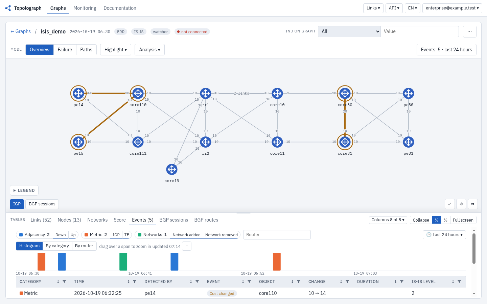
*Events on the graph and on the timeline: Graphs, open a graph, **Events** tab. The table shows the IS-IS level of each event.*

## What you see in Topolograph
**Monitoring.** Events as a histogram by category over the period you pick, with the events table below (here: the 13-router demo, L2 events of pe14, pe15 and core31 and an L1 metric change between core30 and core31). Open **Monitoring** in the top menu. Routers are listed by their IS-IS system ID.
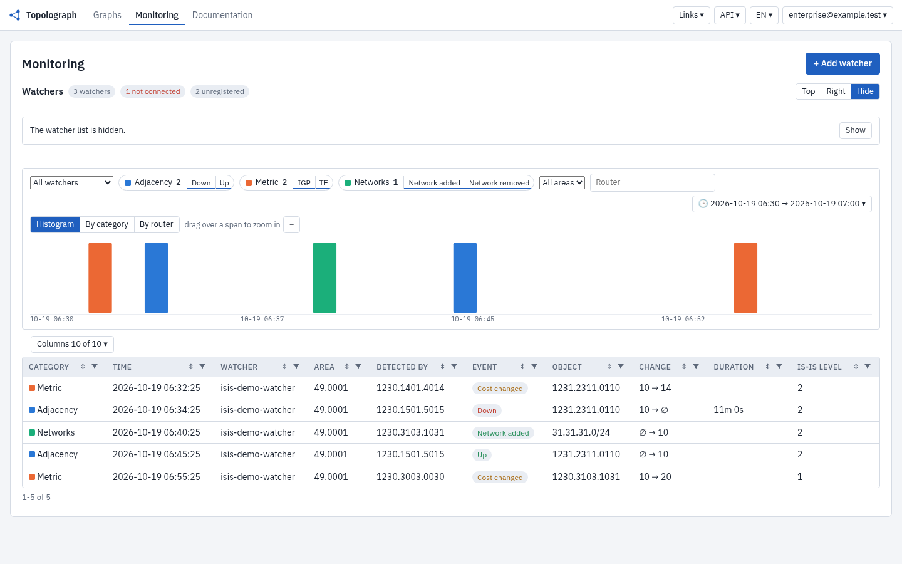

**Events by router.** The same period grouped by the router that detected the change. In a graph, open the **Events** tab and choose **By router**.
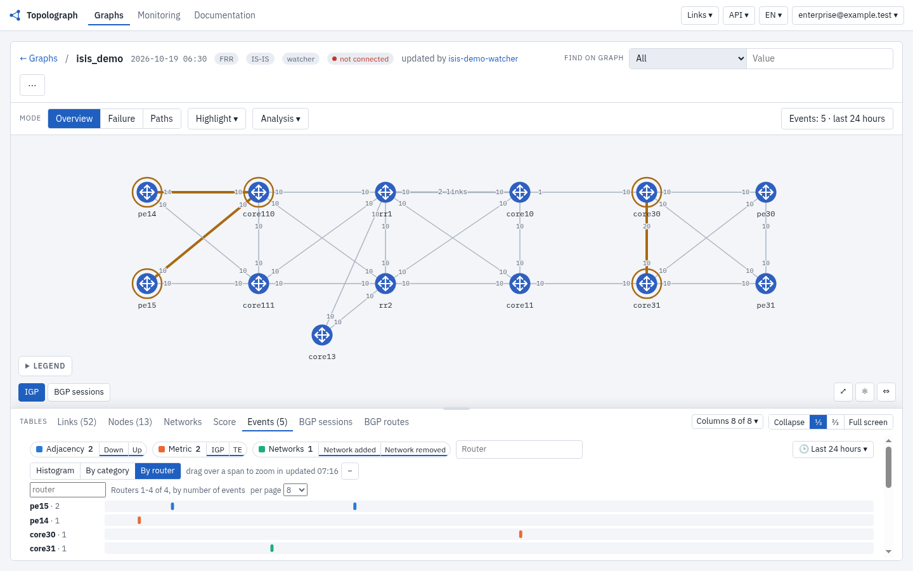

**Event search.** The events table filtered by router, event type and period. On the **Monitoring** page here: router `1230.1501.5015` (pe15), adjacency down events, a chosen period.
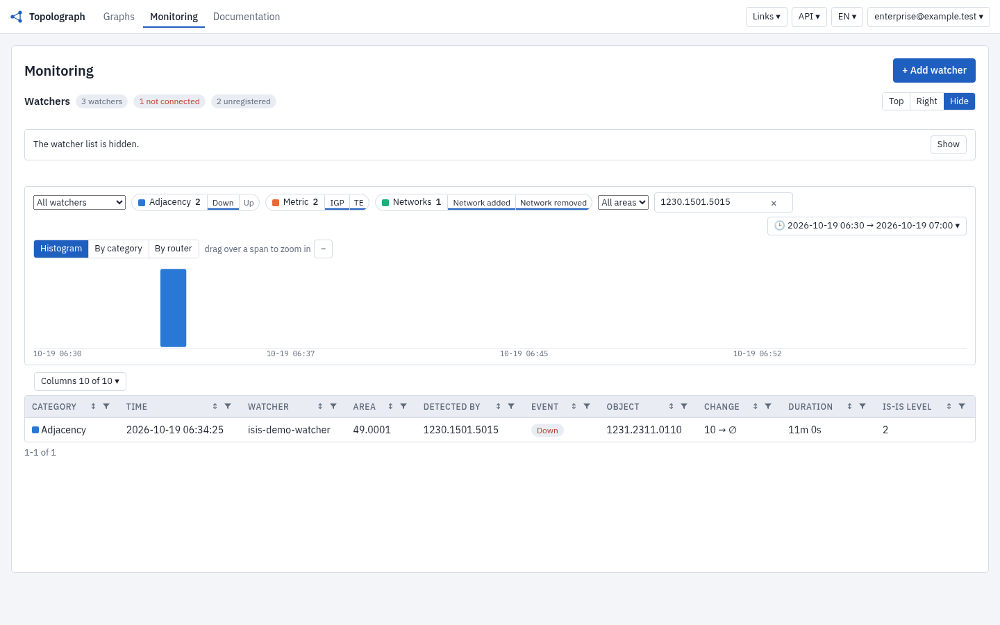

**The graph at the moment of an event.** Click an event in the **Events** tab to open the graph as it was at that time. After the L2 adjacency down event (pe15, core110) the link between them is drawn as down. **Back to live** returns to the current graph.
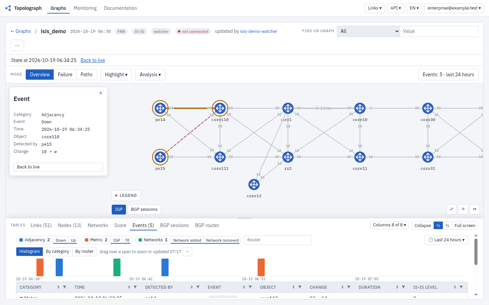

**A metric change on the graph.** The selected event row (pe14, core110, 10 → 14 on L2) is in the **Events** tab and the changed link is highlighted on the graph.
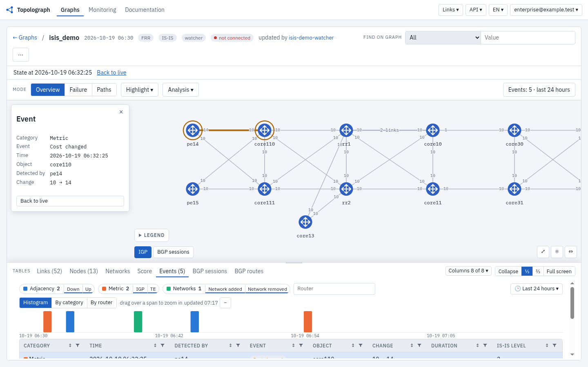

## Quick start
1. Enterprise: in Topolograph open **Add → Watcher**, choose the type (IS-IS Watcher) and the mode (GRE or BGP-LS) and fill in the form. The wizard issues a watcher token and shows one install command.

    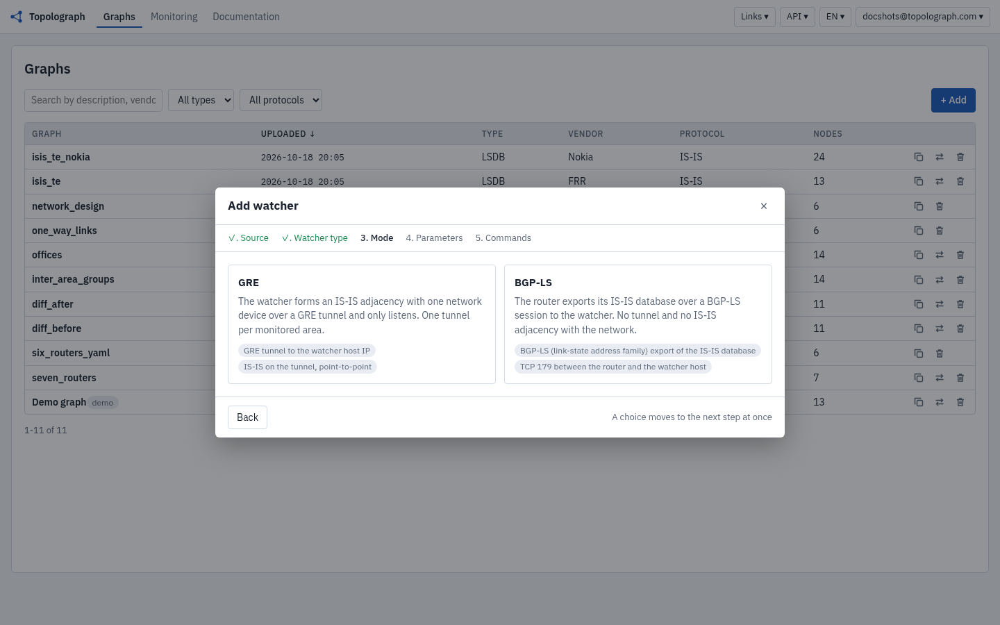

    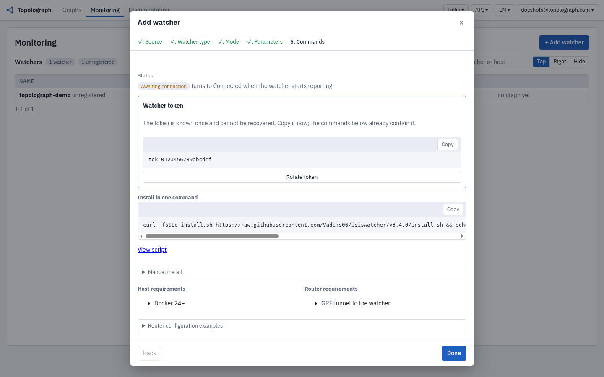

2. Run the command on a Docker host with containerlab. It downloads `install.sh` pinned to a release tag, checks its SHA-256 and runs it with `--url`, `--token` and `--ref`:

    ```bash
    curl -fsSLo install.sh https://raw.githubusercontent.com/Vadims06/isiswatcher/<version>/install.sh \
      && echo "<sha256>  install.sh" | sha256sum -c \
      && sudo bash install.sh --url <topolograph-url> --token <watcher-token> --ref <version>
    ```

    `install.sh` clones this repository into `/opt/topolograph/isiswatcher`, checks out the tag and starts `configure.sh`. The same steps by hand:

    ```bash
    # 1. Download
    [ -d /opt/topolograph/isiswatcher ] || sudo git clone https://github.com/Vadims06/isiswatcher /opt/topolograph/isiswatcher
    cd /opt/topolograph/isiswatcher && sudo git fetch --tags origin <version> && sudo git checkout --detach FETCH_HEAD
    # 2. Configure and run
    sudo ./configure.sh --url <topolograph-url> --token <watcher-token>
    ```
    `configure.sh` checks Docker, Docker Compose, containerlab, curl, git, systemd and root, fetches your answers from Topolograph, builds the watcher with `client.py --answers` and starts it from the `topolograph-isiswatcher` systemd service, which brings the watchers back after a reboot. All watchers of one checkout share its version: `configure.sh` rebuilds each of them from its own registration.
3. Configure the router as the watcher page shows. The page shows when the command ran, when data arrived and a link to the graph; once data arrives the watcher shows "Connected".

No events on the dashboard? Start with [Troubleshooting](#troubleshooting).

### Requirements and more watchers
1. Choose a Linux host with Docker, Docker Compose v2, [containerlab](https://containerlab.dev/install/), curl and git; GRE mode also needs iptables and conntrack.
2. Launch your own Topolograph with [topolograph-docker](https://github.com/Vadims06/topolograph-docker) or use the public https://topolograph.com.
3. To add another watcher on the same host, repeat step 1 of the Quick start: every watcher of the checkout is rebuilt from its own registration. To change answers or after **Rotate token**, run `configure.sh` again; when a newer version is out, the watcher page shows the update command.
4. Configure the network device, see [Device configuration](#device-configuration).

### Moving a watcher installed by hand
To move a watcher set up by hand to Topolograph:
1. Stop it in its old checkout with `sudo containerlab destroy -t watcher/<watcher folder>/config.yml` and move that folder out of the checkout. Two GRE watchers towards one router from one host cannot run at the same time.
2. Add it on the Monitoring page with the same answers and run the command the page shows.

The manual setup is described in [docs/exporters.md](docs/exporters.md).

### Removing a watcher
Deleting a watcher in Topolograph revokes its token; its containers keep running on the host until you stop them. To remove one watcher of an installed checkout:
```
cd /opt/topolograph/isiswatcher
sudo onboarding/stop.sh watcher/<watcher folder>/config.yml
sudo mkdir -p watcher/.removed && sudo mv watcher/<watcher folder> watcher/.removed/
```
To remove every watcher of the host: `sudo systemctl disable --now topolograph-isiswatcher`. Both also remove the GRE rules and connection-tracking entries that `containerlab destroy` leaves behind.

## IS-IS Watcher detects the following network events:
* IS-IS neighbor adjacency Up/Down
* IS-IS link cost changes
* IS-IS networks appearance/disappearance from the topology
* IS-IS TE attributes:
  * Administrative Group (color, resource class)
  * Maximum Link Bandwidth
  * Maximum Reservable Link Bandwidth
  * Unreserved Bandwidth
  * Traffic Engineering Default Metric


## Architecture

### Connection Modes

IS-IS Watcher supports two connection modes:

#### GRE Mode (Traditional)
The FRR container is isolated in an individual network namespace and establishes an IS-IS adjacency over a GRE tunnel with a network device. The **announcement filter** (a tc-BPF program on the egress of `gre1`) lets out the hellos and sequence-number PDUs, but of all LSPs only the watcher's own one, and only with the tunnel subnet as its prefix. Any other LSP, extra prefix or malformed PDU is dropped, so the watcher cannot populate the network with unexpected prefixes or forward the network's LSPs.

#### BGP-LS Mode
The watcher connects to a network router via BGP-LS (BGP Link-State) protocol. The router must be configured to advertise IS-IS topology information via BGP-LS. The watcher uses GoBGP (bgplswatcher) to establish a BGP session and receive BGP-LS updates, which are then processed by the IS-IS watcher component. This mode eliminates the need for GRE tunnels and IS-IS adjacencies, making it easier to deploy in environments where GRE tunnels are not feasible.

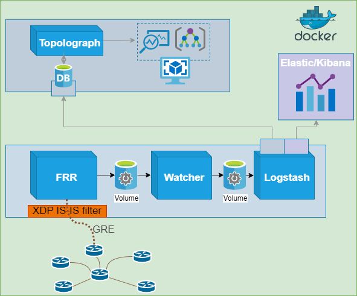  

> [!NOTE]
> isiswatcher:v1.0 is compatible with [topolograph:v2.38](https://github.com/Vadims06/topolograph/releases/tag/v2.38)
> , it means that IS-IS network changes can be shown on the network graph.

### Functional Role
Watcher stores topology events/state to show historical network state, whereas Topolograph exhibits present network state and potential future outcomes.   
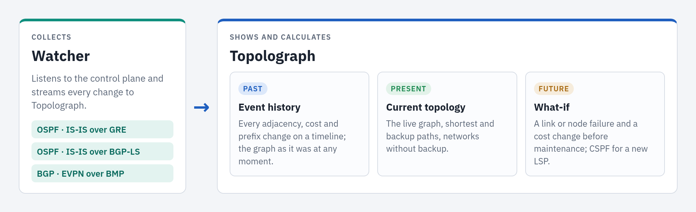

### Supported IS-IS TLV 
| TLV name                         | TLV | subTLV                 |
|----------------------------------|-----|------------------------|
| IS Reachability                  | 2   |                        |
| Extended IS Reachability   (new) | 22  | 3,6,8,9,10,11,12,13,18 |
| IPv4 Internal Reachability (old) | 128 |                        |
| IPv4 External Reachability (old) | 130 |                        |
| Extended IPv4 Reachability (new) | 135 |                        |
| IPv6 Reachability                | 236 |                        |

### Network architecture  
**GRE Mode**: Number of watchers is equal to the number of IS-IS areas and each Watcher is placed in individual network namespace. IS-IS LSDB sits in watcher's namespace and doesn't interact with other Watchers keeping it isolated.  
**BGP-LS Mode**: Each watcher connects to a BGP-LS capable router. Multiple watchers can connect to the same router if it advertises multiple IS-IS areas, or each watcher can connect to different routers.  
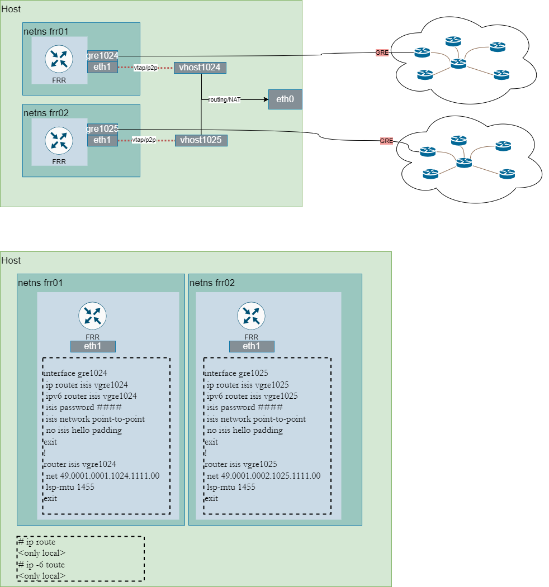  

## Demo
The demo shows how IS-IS watcher detected:
* p2p links:
1. metric cost changes on eth1 interface on router2 from 10 to 11. There were three duplicated logs for each level: L1 and L2.
2. 0100.1001.0002 (router2) went down for L2 after applying "isis circuit-type level-1" on it and router3 detected that.
3. metric cost changes on eth1 interface on router2 from 11 to 12 only for L1.
* broadcast links:
4. new stub network was added on router6 in L2
5. 0100.1001.0004 went down and 0100.1001.0005 (router5) detected that 


## Watcher Heartbeats

A watcher added on Topolograph's Monitoring page sends heartbeats with its own token and needs no setup.

| Status | Meaning |
|--------|---------|
| `up` | Last heartbeat received within `HEARTBEAT_INTERVAL × 3` seconds |
| `stale` | Last heartbeat older than `× 3` but within `× 6` seconds |
| `down` | No heartbeat for more than `× 6` seconds, or watcher never connected |

| Variable | Default | Description |
|----------|---------|-------------|
| `HEARTBEAT_INTERVAL` | `60` | Seconds between heartbeats. |
| `WATCHER_IP` | _(auto)_ | Override the watcher's reported source IP (`srcid`). Useful in containers where hostname resolution returns `127.0.1.1`. |


## Quick lab
#### Containerlab
Containerlab's topology is placed under **containerlab** folder. Local `README` includes instructions how to run it. IS-IS topology changes are printed by Watcher in a text file only.
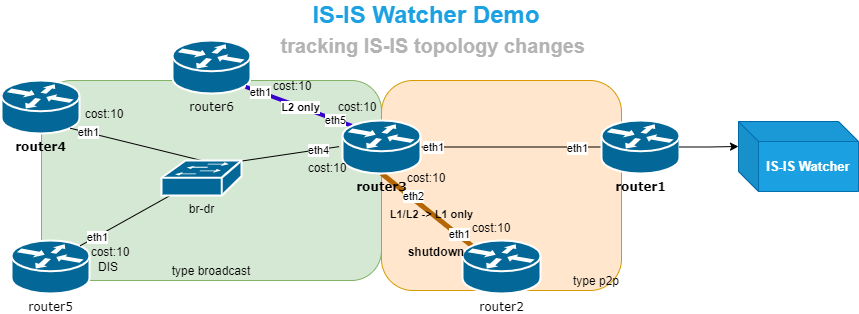
```
./containerlab/isis01/prepare.sh
sudo clab deploy --topo ./containerlab/isis01/isis01.clab.yml
```   


## Device configuration

### For GRE Mode:
Setup GRE tunnel from the network device to the host with the Watcher. An example for Cisco:

```bash
interface gigabitether0/1
ip address <GRE tunnel ip address>
tunnel mode gre
tunnel source <router-ip>
tunnel destination <host-ip>
ip router isis <name>
isis network point-to-point
```
It's needed to have a minimum one GRE tunnel to an area, which is needed to be monitored. If the IS-IS domain has multiple areas, setup one GRE in each area. It's a restriction of Link State architecture to know about new/old adjacency or link cost changes via LSPs per area basis only.

### For BGP-LS Mode:
Configure the network router to advertise IS-IS topology via BGP-LS. The router must:
- Support BGP-LS (BGP Link-State) protocol
- Be configured to redistribute IS-IS topology into BGP-LS
- Establish a BGP session with the watcher's bgplswatcher instance

Example configuration for routers supporting BGP-LS (syntax varies by vendor):

**Juniper JunOS:**
> **Version Requirements:**
> - Starting with Junos OS Release 14.2 (M Series, MX Series, or T Series routers), the traffic engineering database only exported RSVP-TE topology information
> - Starting in Junos OS Release 17.4R1, TED exports non RSVP-TE topology information as well
> - Starting in Junos OS Release 20.4R1, you can configure IS-IS traffic engineering to store IPv6 information in the traffic engineering database (TED) in addition to IPv4 addresses

```bash
# Configure policy to import IS-IS and OSPF into TED
set protocols mpls traffic-engineering database import policy ted2nlri
set policy-options policy-statement ted2nlri term 1 from protocol isis
set policy-options policy-statement ted2nlri term 1 from protocol ospf
set policy-options policy-statement ted2nlri term 1 then accept
set policy-options policy-statement ted2nlri term 2 then reject

# Configure IS-IS traffic engineering and BGP-LS export
set protocols isis traffic-engineering l3-unicast-topology
set protocols mpls traffic-engineering database import l3-unicast-topology bgp-link-state
set protocols mpls traffic-engineering database import policy ted2nlri

# Configure BGP export policy for IS-IS
set protocols bgp export isis2bgp
set policy-options policy-statement isis2bgp term 1 from protocol isis
set policy-options policy-statement isis2bgp term 1 then accept
```

**Cisco IOS XR**: TODO <config sample>

**Mikrotik**: BGP-LS is not supported

The watcher will connect to the router's BGP-LS peer IP address specified during configuration. 

### Listen-only mode. Announcement filter in action.
If, for some reason, an extra network is advertised from Watcher, this announcement will be dropped.  
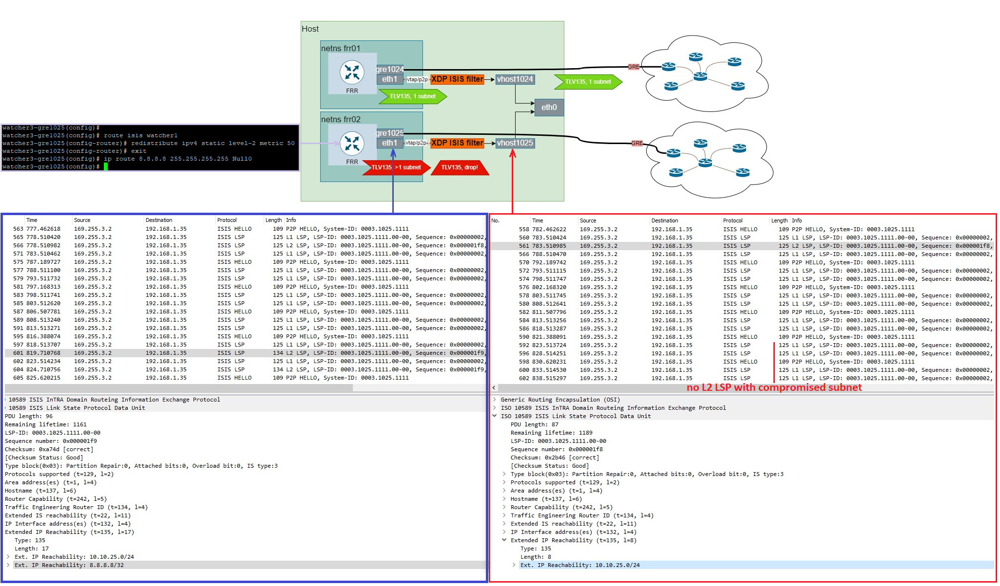  
This example shows that the `8.8.8.8` prefix was redistributed on Watcher and added into its announcement, but it was dropped by the filter and eventually didn't reach the network.

What leaves `gre1`:

| PDU | Verdict |
|---|---|
| Hello (IIH), CSNP, PSNP | passes |
| LSP of the watcher (its system id, pseudonode 0) with at most one point-to-point neighbour and the tunnel subnet as the only prefix | passes |
| LSP of any other system, pseudonode LSP, extra IPv4 prefix, any IPv6 prefix, external IP reachability, malformed, truncated or unknown PDU | dropped |
| Anything that is not IS-IS | passes |

Known limit: the watcher never sends other systems' LSPs, so a device that has just rebooted gets nothing from it except the watcher's own LSP; it learns the topology from its other neighbours.

The filter node `receive_only_filter` runs once in the FRR network namespace (capabilities `NET_ADMIN`, `BPF`, `PERFMON`, Linux 5.4 or newer), attaches the program and brings `gre1` up, so nothing leaves the tunnel before the filter is on it. If it fails, `gre1` stays down.

To check that the filter is attached and what it dropped
```
sudo ip netns exec <netns> tc filter show dev gre1 egress        # shows "id <program id>"
sudo bpftool prog show id <program id>                            # shows "map_ids <ids>"
sudo bpftool map dump id <id>                                     # the map with 7 entries: lsp_passed, truncated, unknown_pdu, foreign_lsp, malformed_tlv, neighbor, prefix
```
To enable/disable the filter of a watcher, then redeploy it
```
cd /opt/topolograph/isiswatcher && sudo docker run -it --rm -v ./:/home/watcher/watcher/ --cap-add=NET_ADMIN -u root --network host vadims06/isis-watcher:$(cat VERSION) python3 ./client.py --action enable_filter --watcher_num <num>
sudo containerlab deploy --reconfigure -t watcher/<watcher folder>/config.yml
```
Use `--action disable_filter` to switch it off. Without the filter node the lab node `h2` brings `gre1` up.

To run the filter tests (they load the program into the host kernel from a privileged container): `filter/tests/run.sh`.

## Troubleshooting
Start on the watcher's page in Topolograph (**Monitoring**, then the watcher): it shows which step is missing: the install command ran, data arrived, the graph exists.

On the watcher host an installed watcher lives in `/opt/topolograph/isiswatcher`:
* `sudo systemctl status topolograph-isiswatcher` shows whether the watchers started.
* `sudo docker logs isis-fluentbit` shows delivery to Topolograph. `401` means the watcher's token was rotated: run the command from its watcher page again. A deleted watcher gets `401` too: remove it from the host, see [Removing a watcher](#removing-a-watcher). `403` means the event names a graph that does not belong to this watcher.

##### Symptoms
Network changes are not tracked: the watcher log `watcher/logs/watcher<num>-...log` (under `/opt/topolograph/isiswatcher` for an installed watcher) stays empty. `<num>` is the number in the watcher's folder name: `ls /opt/topolograph/isiswatcher/watcher/`.

##### Steps:

**For GRE Mode:**
1. Run diagnostic script. It will check **IS-IS Watcher** <-> **Network device** connection (iptables, packets from FRR/network device)

    ```
    cd /opt/topolograph/isiswatcher && sudo docker run -it --rm -v ./:/home/watcher/watcher/ --cap-add=NET_ADMIN -u root --network host vadims06/isis-watcher:$(cat VERSION) python3 ./client.py --action diagnostic --watcher_num <num>
    ``` 
2. Login on FRR, check adjancency:   
    ```
    sudo docker exec -it watcher<num>-gre<num>-isis-router vtysh
    show isis neighbor
    ```
    if there is no IS-IS neighbor, ping remote end of GRE tunnel from the Watcher. At the same time, make tcpdump on watcher's interface and check counters of iptables   
    ```
    sudo iptables -nvL -t filter --line-numbers
    sudo iptables -nvL -t nat --line-numbers
    ```
    Clear connections of GRE tunnel
    ```
    sudo conntrack -D -p 47
    ```
    Check ICMP ping packets on Watcher's host and on network device.

**For BGP-LS Mode:**
1. Check bgplswatcher container logs:
    ```
    sudo docker logs watcher<num>-bgpls-isis-bgplswatcher
    ```
    IS-IS Watcher posts topology to Topolograph after 30 sec from establing BGP session.   

2. Verify BGP session is established using gobgp CLI:
    ```bash
    # List all BGP neighbors with session status
    docker exec -it watcher<num>-bgpls-isis-bgplswatcher gobgp neighbor
    
    # Show detailed status for a specific neighbor
    docker exec -it watcher<num>-bgpls-isis-bgplswatcher gobgp neighbor <neighbor-ip-address>
    
    # Check routes received from a neighbor (BGP-LS address family)
    docker exec -it watcher<num>-bgpls-isis-bgplswatcher gobgp neighbor <neighbor-ip> adj-in -a ls
    
    # Check global RIB (accepted routes)
    docker exec -it watcher<num>-bgpls-isis-bgplswatcher gobgp global rib -a ls
    ```
    The `gobgp neighbor` command shows:
    - **Peer**: Neighbor IP address
    - **AS**: Remote AS number
    - **Up/Down**: Session uptime
    - **State**: Session state (`Establ` = Established, `Idle`, `Connect`, `Active`, etc.)
    - **#Received**: Number of routes received
    - **Accepted**: Number of routes accepted

    > Run `sudo sysctl -w net.ipv4.ip_unprivileged_port_start=0` on the Linux host to allow GoBGP on port 179 if needed to start goBGP in passive mode.
3. Check IS-IS watcher container logs:
    ```
    sudo docker logs watcher<num>-bgpls-isis-isis-watcher
    ```
4. Verify gRPC connection between bgplswatcher and isis-watcher:
    - Check that gRPC port (default: 50100+watcher_num for IS-IS) is accessible
    - Verify both containers are running and can communicate
##### Symptoms
The watcher log has changes, but Topolograph shows no events.
##### Steps:
The chain is: FRR (GRE mode) or bgplswatcher (BGP-LS mode) -> Watcher -> Fluent Bit -> Topolograph.
1. Check that the watcher log has the change, as in the previous case:
    ```
    2024-10-08T22:54:54Z,watcher1,1,network,4ffe::192:168:145:4/127,changed,old_cost:44,new_cost:4,0200.1001.0004,,49.0002,12345,internal,0
    ```
2. Check that `isis-fluentbit` is running (`sudo docker ps`) and that its logs show no `401` or `403` (see above).

For a watcher that feeds ELK, Zabbix, Loki or webhooks through Logstash, see [Troubleshooting Logstash](docs/exporters.md#troubleshooting-logstash).

 ### Versions
 #### FRR
FRR 8 perfectly logs any IS-IS LSPs, but doesn't establish IS-IS adjacency over GRE because of internal packet filtering. The filter has been updated to permit IS-IS over GRE through Pull request [#12979](https://github.com/FRRouting/frr/pull/12979) and is only supported in FRR 9 versions. However, this version has wrong LSDB output (mix LSPID with hostnames) and is incompatible with the Watcher. Therefore, a custom FRR build based on FRR 8.x version with an altered internal filter for GRE packets is required. `vadims06/frr:v8.5.4_isis_over_gre` is prepaired and tested to work IS-IS over GRE tunnel. If you need another 8.x version or want to build your own FRR image - follow the instructions mentioned below.
 #####  How to prepare FRR instance (optional)
 1. clone FRR and choose any FRR 8.x branch
 ```
 git clone https://github.com/FRRouting/frr.git
 cd frr
 git fetch --all --tags
 git checkout tags/frr-8.5.4 -b frr-8.5.4
 ```
 2. Change isis filter `frr/isisd/isis_pfpacket.c` how it's mentioned in this [GRE filter](https://github.com/FRRouting/frr/pull/12979) CR.
 ```
 vi frr/isisd/isis_pfpacket.c
 ```
 3. Build FRR container
 ```
 sudo docker/alpine/build.sh
 ```
 4. Inspect your new FRR image name using `docker image ls` and replace `router/image` by your own image name in `isiswatcher/watcher/watcher-template/config.yml`

### Topolograph suite
* OSPF Watcher [link](https://github.com/Vadims06/ospfwatcher)
* IS-IS Watcher [link](https://github.com/Vadims06/isiswatcher)
* Topolograph [link](https://github.com/Vadims06/topolograph)
* Topolograph in docker [link](https://github.com/Vadims06/topolograph-docker)

### Community & feedback
* https://t.me/topolograph
* admin at topolograph.com

 ### License
 The functionality was tested using Basic ELK license.  

[Other exports (ELK, Zabbix, Loki, webhooks)](docs/exporters.md)

> Watchers that feed Topolograph are an **Enterprise** feature; Community Topolograph has no watchers. Editions and contact: https://topolograph.com/#editions.
