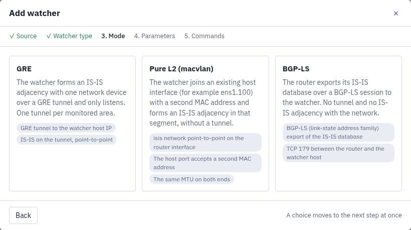
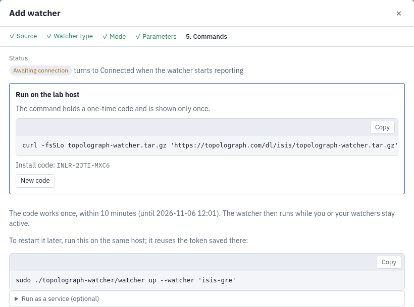
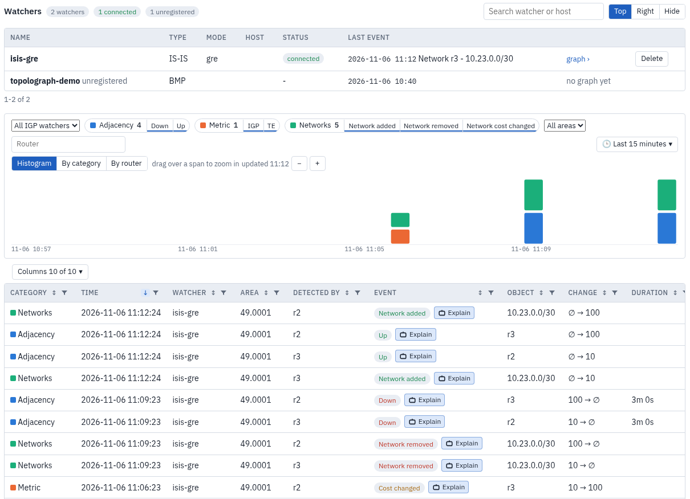
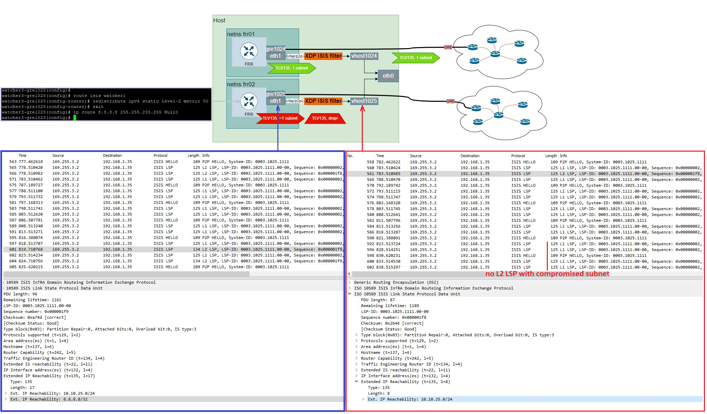
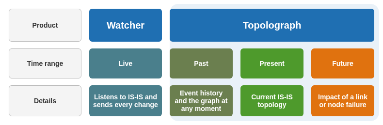
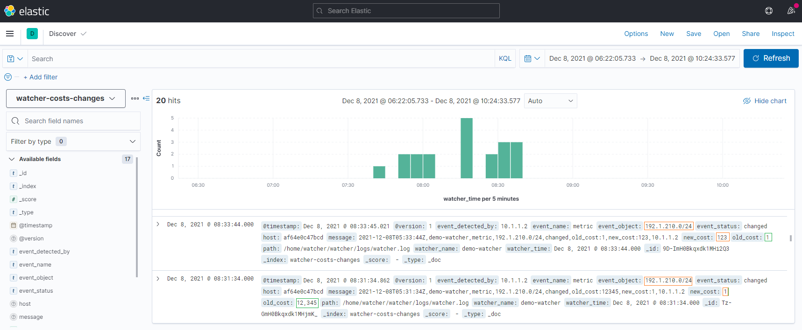
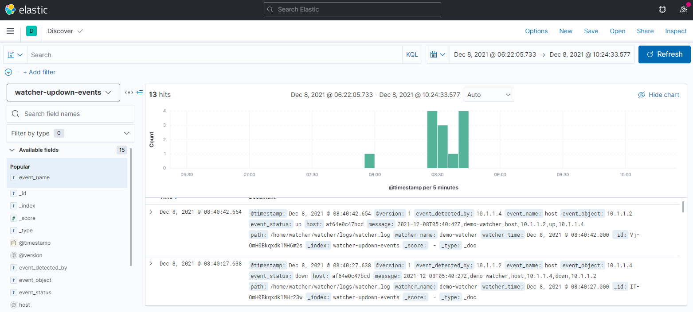
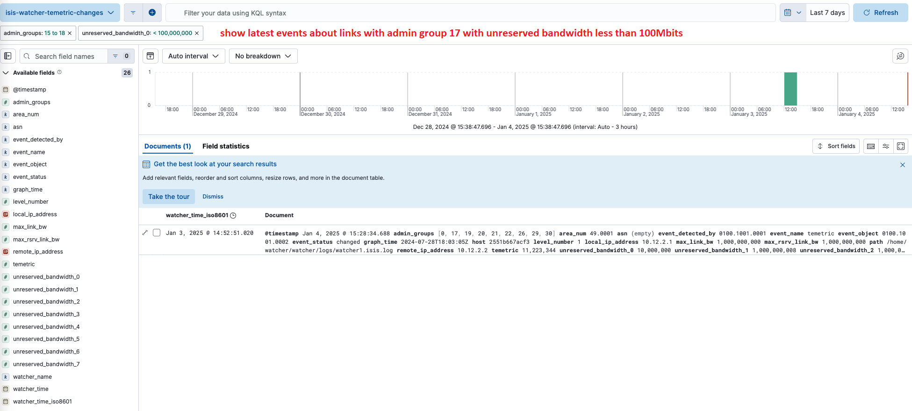
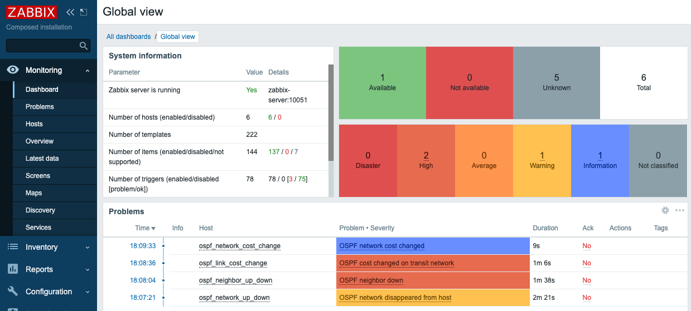
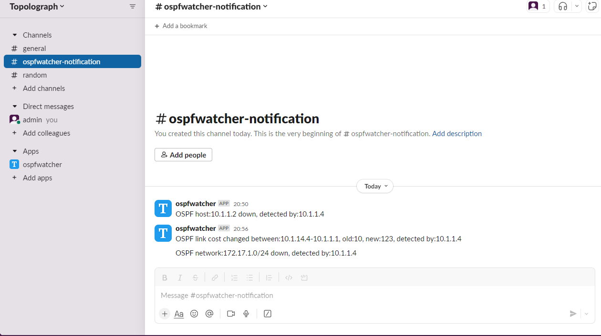

# IS-IS Topology Watcher
IS-IS Watcher logs IS-IS topology changes for network engineers: adjacencies, link metrics, prefixes, node flags and TE attributes, per level. It listens to the IS-IS control plane passively, in one of three connection modes (GRE, Pure L2 (macvlan) or BGP-LS), and sends every change to Topolograph. There you see the change on the network graph and keep the history of events.

## Quick start: a watcher on topolograph.com
Watchers with live events and event history run on [topolograph.com](https://topolograph.com). They are free.

1. Sign in, open **Monitoring** and press **+ Add watcher**.
2. Choose **IS-IS Watcher**, the connection mode, and fill in the parameters.
3. Run the command the page shows on a Linux x86_64 host. It downloads the watcher, checks its SHA-256 and starts it with a one-time code. The code works once, within 10 minutes.
4. Configure the router from the example on the same page. The watcher turns **connected** on the Monitoring page, and its **Last event** follows new events.

 

| Mode | How the watcher joins | Router | Watcher host | Demo |
|---|---|---|---|---|
| GRE | IS-IS adjacency over a GRE tunnel. A filter drops any announcement beyond the tunnel network. | GRE tunnel to the host, IS-IS point-to-point on it | `ip_gre` module, GRE (IP protocol 47) from the router allowed in | [video](https://topolograph.com/videos/2-isis-gre.mp4) |
| Pure L2 (macvlan) | A second MAC on an existing host interface, for example `ens192.100`, and an IS-IS adjacency on that segment. No tunnel. The filter is always on. | `isis network point-to-point` on the interface in that segment, the same MTU. On a broadcast segment one side becomes DIS, and priority 0 does not prevent that. | `macvlan` module; the switch or hypervisor port accepts a second MAC; one watcher per host interface | [video](https://topolograph.com/videos/5-isis-macvlan.mp4) |
| BGP-LS | The router exports its IS-IS database over BGP-LS. No tunnel, no IS-IS adjacency. | BGP-LS (link-state address family) to the host | TCP 179 between the host and the router | [video](https://topolograph.com/videos/8-isis-bgpls.mp4) |

A watcher works together with Topolograph: it sends its data there and stops when Topolograph is unreachable or its token has ended.

### Topolograph IS-IS Monitoring
The Monitoring page shows each watcher with its last event, and every event on the histogram and in the table. Click an event to open the graph as it was at that time.
  

No events on the dashboard? Start with [Troubleshooting](#troubleshooting).

The self-hosted Topolograph from [topolograph-docker](https://github.com/Vadims06/topolograph-docker) takes no IS-IS watcher data. To see events in Topolograph, start the watcher on topolograph.com.

## IS-IS Watcher detects the following network events:
* IS-IS neighbor adjacency Up/Down
* IS-IS link cost changes
* IS-IS networks appearance/disappearance from the topology
* IS-IS TE attributes:
  * Administrative Group (color, resource class)
  * Maximum Link Bandwidth
  * Maximum Reservable Link Bandwidth
  * Unreserved Bandwidth
  * Traffic Engineering Default Metric
  * Shared Risk Link Group (SRLG)
* IS-IS node flags: overload and attached

## Architecture

### Connection Modes
IS-IS Watcher joins the network in one of three ways:

* **GRE.** The router and the watcher host build a GRE tunnel. The watcher runs FRR's IS-IS daemon in its own network namespace and forms a point-to-point IS-IS adjacency over the tunnel, so it receives every LSP flooded at that level.
* **Pure L2 (macvlan).** The same, without a tunnel: a second MAC address on an existing host interface, for example the VLAN interface `ens192.100`, places the watcher on a router's segment.
* **BGP-LS.** The router exports its IS-IS database to the watcher over a BGP-LS session (TCP 179). There is no tunnel and no IS-IS adjacency.

In Pure L2 mode, and in GRE mode unless you turn it off, an eBPF filter on the watcher's interface lets out only the watcher's own minimal LSP, so the watcher never announces prefixes into your IS-IS domain. In these two modes each watcher has its own network namespace, so several watchers on one host do not see each other's routes. In BGP-LS mode the watcher is itself the BGP-LS speaker and needs no namespace or FRR.

The watcher keeps the link-state database and derives each change from the database before and after an LSP arrives. Changes go to Topolograph only; the watcher does not write them to a local file.

### Announcement filter in action
If the watcher's IS-IS ever announces more than its own minimal LSP, the filter drops that LSP before it leaves the watcher.



`8.8.8.8` was redistributed on the watcher and added to its announcement. The filter dropped it, and it never reached the network.
On start the watcher prints `Announcement filter is attached to <interface>: only the watcher's own minimal LSP can leave`, or `Announcement filter is off for this watcher`.

### Functional Role
The watcher reports topology changes as they happen and Topolograph keeps them as history. Topolograph also shows the present network state and potential future outcomes.   


### Supported IS-IS TLV
| TLV name                              | TLV | subTLV                   |
|---------------------------------------|-----|--------------------------|
| Area Addresses                        | 1   |                          |
| IS Reachability                       | 2   |                          |
| Extended IS Reachability              | 22  | 3,4,6,8,9,10,11,12,13,18 |
| MT IS Reachability                    | 222 | as TLV 22                |
| IPv4 Internal / External Reachability | 128, 130 |                     |
| TE Router ID                          | 134 |                          |
| Extended IPv4 Reachability            | 135 |                          |
| Dynamic Hostname                      | 137 |                          |
| IPv4 / IPv6 SRLG                      | 138, 139 |                     |
| MT IPv4 Reachability                  | 235 |                          |
| IPv6 Reachability                     | 236 |                          |
| MT IPv6 Reachability                  | 237 |                          |

### Network architecture
In GRE and Pure L2 mode the watcher follows the IS-IS level of its adjacency. Each event carries the area of the router whose LSP produced it. In BGP-LS mode the watcher gets what the router exports, and several watchers may peer with the same router.

## Demo
A short video for each connection mode is linked in the table in [Quick start](#quick-start-a-watcher-on-topolographcom).

## Router configuration
The **+ Add watcher** page shows the router configuration for the mode you picked, with your addresses filled in. The examples below show the same with placeholders.

### GRE
The router needs a GRE tunnel to the watcher host and IS-IS point-to-point on it.

FRR (Linux shell of the router, then vtysh):
```
ip tunnel add gre1026 mode gre local <router-ip> remote <watcher-host-ip> ttl 255
ip addr add <tunnel-ip-on-router>/30 dev gre1026
ip link set gre1026 up

interface gre1026
 ip router isis <name>
 isis network point-to-point
```
Cisco IOS:
```
interface Tunnel1026
 ip address <tunnel-ip-on-router> 255.255.255.252
 tunnel mode gre ip
 tunnel source <router-ip>
 tunnel destination <watcher-host-ip>
 ip router isis <name>
 isis network point-to-point
```

### Pure L2 (macvlan)
The router interface sits in the same L2 segment as the watcher host's interface, runs IS-IS point-to-point and has the same MTU. The switch or hypervisor port must accept the watcher's extra MAC address (on VMware: promiscuous mode or forged transmits).

FRR and Cisco IOS:
```
interface <interface-to-watcher-segment>
 ip address <address in the watcher's subnet>
 ip router isis <name>
 isis network point-to-point
```

### BGP-LS
The router exports its IS-IS database over BGP-LS. TCP 179 must be open between the router and the watcher host.

Juniper Junos:
```
set protocols mpls traffic-engineering database import policy ted2nlri
set policy-options policy-statement ted2nlri term 1 from protocol isis
set policy-options policy-statement ted2nlri term 1 then accept
set policy-options policy-statement ted2nlri term 2 then reject
set protocols isis traffic-engineering l3-unicast-topology
set protocols mpls traffic-engineering database import l3-unicast-topology bgp-link-state
# for eBGP: type external, and set protocols bgp group topolograph multihop
set protocols bgp group topolograph type internal
set protocols bgp group topolograph family traffic-engineering unicast
set protocols bgp group topolograph peer-as <watcher-as>
set protocols bgp group topolograph neighbor <watcher-host-ip>
set protocols bgp group topolograph export isis2bgp
set policy-options policy-statement isis2bgp term 1 from protocol isis
set policy-options policy-statement isis2bgp term 1 then accept
```

## Watcher host
* Linux x86_64 host with sudo
* iproute2 (`ip`, and `tc` when the announcement filter is on)
* GRE mode: the `ip_gre` kernel module; the host firewall allows GRE packets (IP protocol 47) from the router
* Pure L2 mode: the `macvlan` kernel module, Linux kernel 5.4 or newer; the parent interface, for example `ens192.100`, is in the router's L2 segment
* Access to topolograph.com over HTTPS

The watcher needs no Docker and no FRR install: the bundle carries the FRR daemons it runs. When it stops, it removes its namespace, tunnel or macvlan interface.

## Run, restart, stop
* The first start uses the command from the **+ Add watcher** page with its one-time code.
* Restart with the saved token: `sudo ./topolograph-watcher/watcher up --watcher <name>`.
* Stop with Ctrl-C. The watcher also stops by itself when its token ends or is refused, or when it cannot reach Topolograph for longer than its lease.

## Troubleshooting
The watcher prints what it waits for. Typical lines:

* `FRR does not have any neighbors, please set up the GRE tunnel or the L2 segment and build IS-IS adjacency first.` The adjacency is not up yet. On the router, check the tunnel or the segment and `show isis neighbor`. In GRE mode, check that the host firewall lets GRE (IP protocol 47) in from the router.
* `POST https://topolograph.com, Status: 200` The topology reached Topolograph. The watcher shows **connected** on the Monitoring page.
* `BGP-LS session with <router> established` The BGP-LS mode is up; the topology follows once the router's export is collected.
* The watcher exits saying the token ended or was refused. Start it again from the **+ Add watcher** page with a new one-time code.

## Other integrations
These integrations have been used with IS-IS Watcher 3.x and its docker compose setup, described in the [3.3.0 README](https://github.com/Vadims06/isiswatcher/blob/v3.3.0/README.md). Watcher 4.0.0 sends events to Topolograph only.

* **Kibana**: browse and filter IS-IS topology change logs, build dashboards.

  

  

  

* **Zabbix**: alarms on IS-IS adjacency, link cost and network changes.

  

* **Loki / Grafana**: IS-IS topology changes as log streams with labels, for Grafana queries.
* **WebHook**: push each change to an HTTP endpoint, for example a Slack channel.

  

### Topolograph suite
* OSPF Watcher [link](https://github.com/Vadims06/ospfwatcher)
* IS-IS Watcher [link](https://github.com/Vadims06/isiswatcher)
* Topolograph [link](https://github.com/Vadims06/topolograph)
* BMP Watcher [link](https://github.com/Vadims06/bmpwatcher)
* Topolograph in docker [link](https://github.com/Vadims06/topolograph-docker)

### Feedback
* https://t.me/topolograph
* admin at topolograph.com

### License
The source in this repository is under the licence in [LICENSE](LICENSE). The watcher bundle ships its own licence, `topolograph-watcher/licenses/EULA.md`, and the licences of the FRR and other components it carries.  
