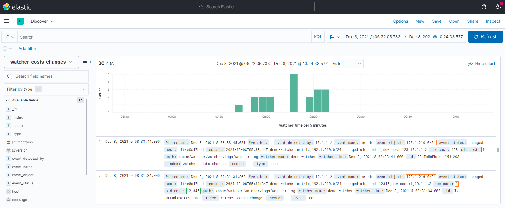
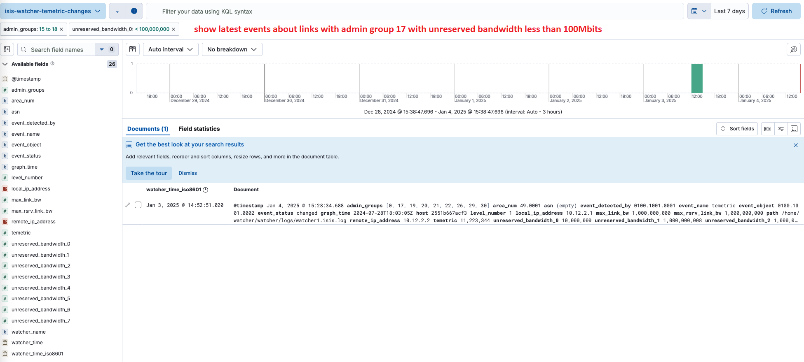
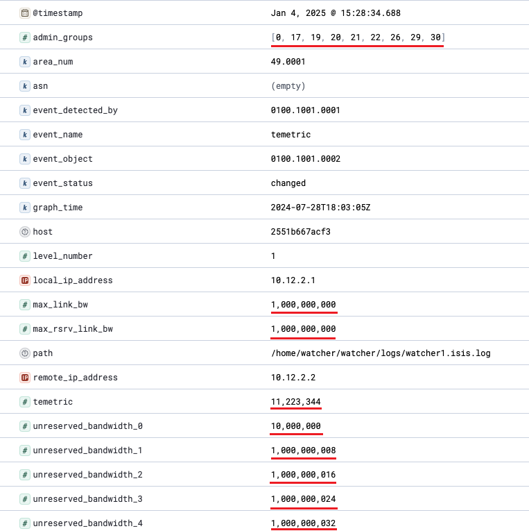
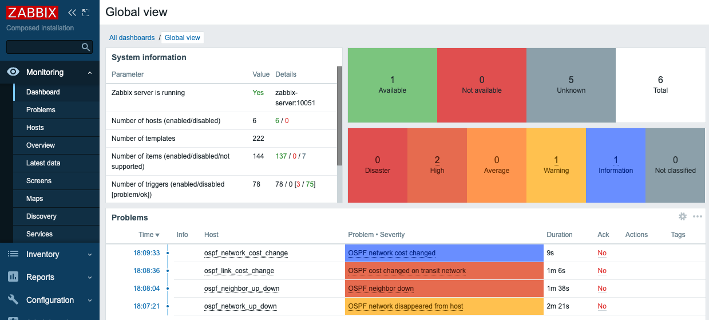
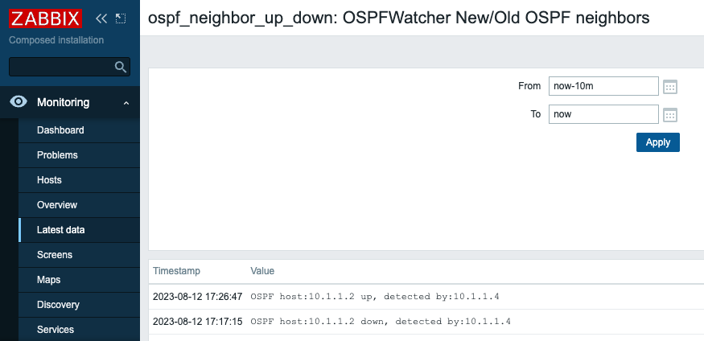
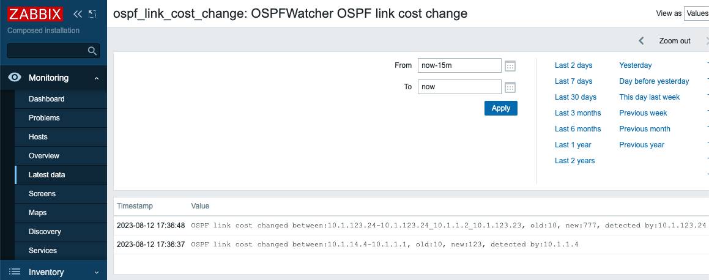
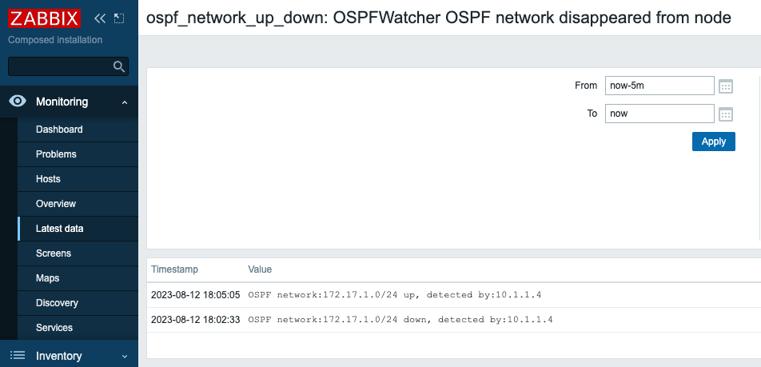
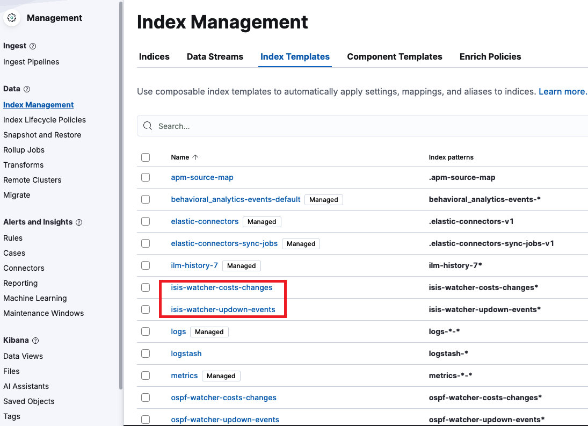
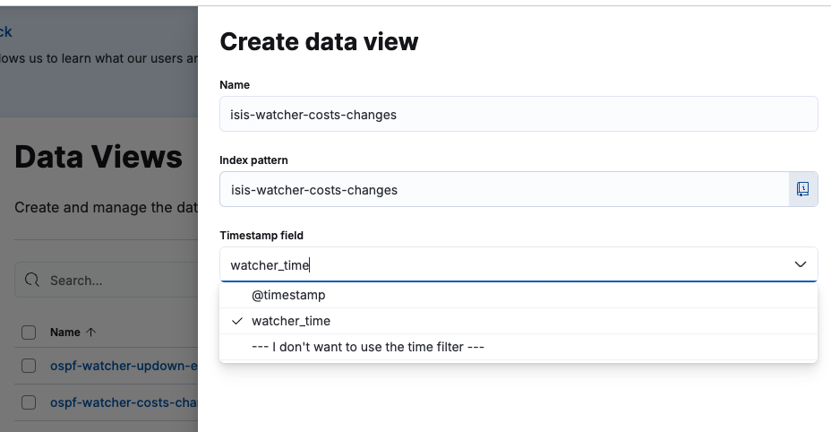
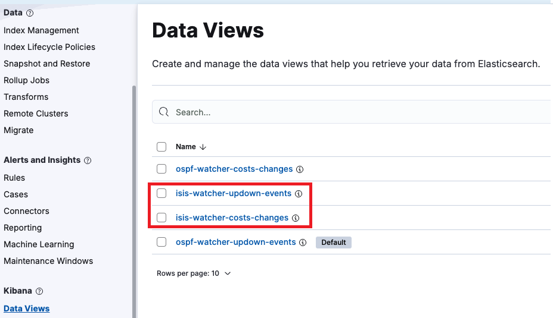

# Other exports: ELK, Zabbix, Loki, webhooks

A watcher writes its events to text logs. Logstash or Fluent Bit can pass them on. This page covers Kibana, Zabbix, Slack and other webhooks, Loki, and the manual setup of a watcher by hand.

## Discovering IS-IS logs in Kibana. Examples
### Cost attribute, metric
IS-IS cost changes on links  


### IS-IS adjacency
Logs if IS-IS adjacency was Up/Down or any networks appeared/disappeared.  


### IS-IS TE metric
Latest events about links with admin group **17** with unreserved bandwidth for priority of 0 less than 100Mbits


### Full IS-IS TE log



## IS-IS topology change notification/alarming via Zabbix. Examples
Zabbix's dashboard with active alarms. It's universal method to track OSPF and IS-IS events. *The screenshot is taken from OSPF watcher.*  

### Zabbix IS-IS neighbor up/down alarm
This alarm tracks all new IS-IS/OSPF adjacencies or when a device loses its neighbor. *The screenshot is taken from OSPF watcher.*  

### Zabbix IS-IS Cost changed on transit links
Transit links are all links between active IS-IS/OSPF neighbors. If cost on a link was changed it might affect all actual/shortest paths traffic follows. *The screenshot is taken from OSPF watcher.*   

### Zabbix alert if IS-IS network was stopped announcing from node
If a subnet was removed from IS-IS/OSPF node (the node withdrew it from the announcement) it means the network from this node became unavailable for others, this event will be logged too. *The screenshot is taken from OSPF watcher.*  


### Slack notification
HTTP POST messages can be easily accepted by messengers, which allows to get instant notifications of IS-IS/OSPF topology changes: *The screenshot is taken from OSPF watcher.*   


## Push IS-IS topology changes to Loki

You can configure [Loki](https://grafana.com/oss/loki/) to receive topology changes. Edit `.env` and set `EXPORT_TO_LOKI_BOOL` and `LOKI_URL`.

Both shippers declare the same stream labels, so one set of Grafana queries
works whichever of them you run:

| Label | Values |
|---|---|
| `job` | `topolograph-isis` |
| `event_name` | `network`, `host`, `metric`, `temetric`, `node` |
| `event_status` | `up`, `down`, `changed` |
| `area_num` | `49.0001` (IS-IS area) |
| `asn` | autonomous system number, e.g. `65001` |
| `watcher_name` | name of the watcher that reported the event |

Example query: `{job="topolograph-isis", event_status="down"}`


## How to connect IS-IS watcher to real network  
Table below shows different options of possible setups, starting from the bare minimum in case of running Containerlab for testing and ending with maximum setup size with Watcher, Topolograph and ELK. Setup **№4** is a watcher installed from Topolograph's Monitoring page, see the [README](../README.md#quick-start). Setups №2 and №3 are set up by hand and feed ELK, Zabbix, Loki and webhooks. 
| № | Deployment size                                                                            | Number of compose files | Text file logs | View changes on network map | Zabbix/HTTP/Messengers notification | Searching events by any field any time |
|---|--------------------------------------------------------------------------------------------|-------------------------|----------------|-----------------------------|-------------------------------------|----------------------------------------|
| 1 | Bare minimum. Containerlab                                                                 |            0            |        ✅       |              ❌              |                  ❌                  |                    ❌                   |
| 2 | Manual setup, no Topolograph, ELK **disabled** | 1 | ✅ | ❌ | ✅ | ❌ |
| 3 | Manual setup, no Topolograph, ELK **enabled** | 2 | ✅ | ❌ | ✅ | ✅ |
| 4 | Enterprise: installed from Topolograph's Monitoring page: Topolograph + **Fluent Bit** | 2 | ✅ | ✅ | HTTP / Webhook only | ❌ |

<details>
<summary><b>Manual setup</b> without Topolograph (text logs, ELK, Zabbix, Loki, webhooks)</summary>

## Setup №2. Text logs, Zabbix, webhooks and Loki without Topolograph
1. Choose a Linux host with Docker installed
2. No Topolograph is needed: a watcher set up by hand keeps its events in local logs and the exporters below.

> [!NOTE]
> * `TEST_MODE` - if mode is `True`, a demo IS-IS events from static file will
>   be uploaded, not from FRR

3. Setup ELK (skip it, it's only needed for setup № 3)  
* if you already have ELK instance running, fill `ELASTIC_IP` in env file and uncomment Elastic config here `isiswatcher/logstash/pipeline/logstash.conf`. Currently additional manual configuration is needed for Index Templates creation, because `create.py` script doesn't accept the certificate of ELK. It's needed to have one in case of security setting enabled. Required mapping for the Index Template is in `isiswatcher/logstash/index_template/create.py`.
To create Index Templates, run:
```
sudo docker run -it --rm --env-file=./.env -v ./logstash/index_template/create.py:/home/watcher/watcher/create.py vadims06/isis-watcher:latest python3 ./create.py
```

To create Index Templates, run:
```
sudo docker run -it --rm --env-file=./.env -v ./logstash/index_template/create.py:/home/watcher/watcher/create.py vadims06/isis-watcher:latest python3 ./create.py
```   
* if not - boot up a new ELK from [docker-elk](https://github.com/deviantony/docker-elk) compose. For demo purporse set license of ELK as basic and turn off security. The setting are in docker-elk/elasticsearch/config/elasticsearch.yml  
```
xpack.license.self_generated.type: basic
xpack.security.enabled: false
```

> [!TIP]
> When the Elastic output plugin fails to connect to the ELK host, it blocks all
> other outputs and ignores `EXPORT_TO_ELASTICSEARCH_BOOL` value from env file.
> Regardless of `EXPORT_TO_ELASTICSEARCH_BOOL` being `False`, it tries to
> connect to Elastic host. The solution - uncomment this portion of config in
> case of having running ELK.

4. Setup IS-IS Watcher
```bash
git clone https://github.com/Vadims06/isiswatcher.git
cd isiswatcher
cp .env.template .env
```
Generate configuration files  
`vadims06/isis-watcher:v1.1` includes a client for generating configurations for each Watcher for each IS-IS area. To generate individual settings - run the client with `--action add_watcher`   
```
sudo docker run -it --rm --user $UID -v ./:/home/watcher/watcher/ -v /etc/passwd:/etc/passwd:ro -v /etc/group:/etc/group:ro vadims06/isis-watcher:latest python3 ./client.py --action add_watcher
```   
The script will prompt you to choose a connection mode: **GRE** or **BGP-LS**.

### GRE Mode Setup
When you select GRE mode, you'll see the following output:
```
+---------------------------+                                        
|  Watcher Host             |                       +-------------------+
|  +------------+           |                       | Network device    |
|  | netns FRR  |           |                       |                   |
|  |            Tunnel [4]  |                       | Tunnel [4]        |
|  |  gre1   [3]TunnelIP----+-----------------------+[2]TunnelIP        |
|  |  eth1------+-isis1-gre1|       +-----+         | IS-IS area num [5]|
|  |            | Host IP[6]+-------+ LAN |--------[1]Device IP         |
|  |            |           |       +-----+         |                   |
|  +------------+           |                       |                   |
|                           |                       +-------------------+
+---------------------------+                                        
```
The script will create:
1. a folder under `watcher` folder with FRR configuration under `router` folder
2. a containerlab configuration file with network settings
3. an individual watcher log file in `watcher` folder.

### BGP-LS Mode Setup
When you select BGP-LS mode, you'll see:
```
+-------------------------------+                                        
|  Watcher Host                 |                       +-------------------+
|  +-------------------+        |                       | Network Router    |
|  | bgplswatcher[3][4]|        |                       |                   |
|  | (GoBGP)           |<-------+BGP Session [1][2]---+ | BGP Session [1][2]|
|  |      [gRPC]       |        |                       |    ^              |
|  |        |          |        |                       |    |              |
|  |        v          |        |                       | BGP-LS            |
|  | isis-watcher      |        |                       |    ^              |
|  | (Python)          |        |                       |    |              |
|  |                   |        |                       | IS-IS [5]         |
|  +-------------------+        |                       |                   |
|                               |                       +-------------------+
+-------------------------------+                                            
```
You'll be prompted for:
- **[1] Router IP address (BGP peer)** - IP address of the router running BGP-LS
- **[2] Router AS number** - AS number of the BGP-LS router
- **[3] Watcher AS number** - AS number for the watcher
- **[4] Watcher router-id** - Router ID for the watcher (IP address format)
- **[5] IS-IS area number** - IS-IS area being monitored (format: 49.xxxx)
- **[6] Passive mode** - Whether to use passive BGP mode (y/N)

The script will create:
1. a folder under `watcher` folder with bgplswatcher configuration
2. a containerlab configuration file
3. an individual watcher log file in `watcher` folder

To stop IS-IS routes from being installed in the host's routing table, we the following policy has been applied on the watcher (GRE mode only):
```bash
# frr/config/isisd.conf
route-map TO_KERNEL deny 200
exit
!
ip protocol isis route-map TO_KERNEL
```

5. Start IS-IS Watcher  
[Install](https://containerlab.srlinux.dev/install/) containerlab
To start the watcher run the following command. `clab deploy` is like a `docker compose up -d` command   
```
sudo clab deploy --topo watcher/watcher<num>-gre<num>-isis/config.yml
```
For BGP-LS mode:
```
sudo clab deploy --topo watcher/watcher<num>-bgpls-isis/config.yml
```

**GRE Mode** will create:
* Individual network namespace for Watcher and FRR
* A pair of tap interfaces to connect the watcher to Linux host
* GRE tunnel in Watcher's namespace
* NAT settings for GRE traffic
* FRR & Watcher instance
* assign XDP IS-IS filter on watcher's tap interface (if enabled)

**BGP-LS Mode** will create:
* bgplswatcher (GoBGP) container for BGP-LS session
* IS-IS watcher container connected via gRPC
* Log rotation container

</details>

<details>
<summary><b>Manual setup</b>, step 7</summary>

7. Start log export to ELK, Zabbix, Loki or webhooks

**Compose profiles (Logstash vs Fluent Bit):**  
- **Logstash (ELK + index templates):** services use Compose profile `logstash`. Run:
  ```bash
  docker compose --profile logstash up -d
  ```
  (equivalent: `docker compose --profile logstash up -d isis-logstash isis-logstash-index-creator`).
- **Fluent Bit only:** profile `fluentbit`. Run:
  ```bash
  docker compose --profile fluentbit up -d isis-fluentbit
  ```
  Pipeline definition: [`fluentbit/fluent-bit.yaml`](../fluentbit/fluent-bit.yaml). Logstash and Fluent Bit send HTTP payloads in different shapes; see **HTTP output: Logstash vs Fluent Bit** under *Versions*.

</details>

## Kibana settings
1. **Index Templates** 
Have been already created by `isis-logstash-index-creator` container in compose yaml file.
Open `Management -> Stack Management -> Index Management ->[ Index Templates ]` to make sure that the following templates are in the list:
* `isis-watcher-costs-changes`
* `isis-watcher-temetric-changes`     
* `isis-watcher-updown-events`
   
2. **Index Pattern**
Create indices with the same name as index templates
Go to:
old ELK `Stack Management/ Kibana/ Stack Management/ Index Pattern -> Create index pattern`
new ELK 8.x `Management -> Stack Management -> Index Management -> [ Indices ]`
then `Create index`
* isis-watcher-costs-changes
* isis-watcher-updown-events
* isis-watcher-temetric-changes
3. **Data View**
Create data view for two event types.
Go to `Management -> Stack Management -> Data Views`
then `Create data view`
```
Name: isis-watcher-costs-changes
Index pattern: isis-watcher-costs-changes
Timestamp field: use watcher time
```
   
Repeat the same for `isis-watcher-updown-events` and for `isis-watcher-temetric-changes`
As a result, there are two data views should be listed
 
> Note
What time to use @timestamp or watcher

It's better to use `watcher` time, because connection between Watcher and  Logstash can be lost, but the watcher continues to log all topology changes with the correct time. When the connection is repaired, all logs will be added to ELK and you can check the time of the incident. If you choose `@timestamp` - the time of all logs will be the time of their addition to ELK.  


4. **Additional checks**
Make sure that:
* `.env` has `EXPORT_TO_ELASTICSEARCH_BOOL=True`
* `./logstash/pipeline/logstash.conf` has ELK uncommented

 ## Zabbix settings
 Zabbix settings are available here ```/docs/zabbix-ui```. There are 4 hosts and items (host and item inside each host has the same names) are required:
 * isis_neighbor_up_down
 * isis_network_up_down
 * isis_link_cost_change
 * isis_stub_network_cost_change

## WebHook setting
1. Create a Slack app
2. Enable Incoming Webhooks
3. Create an Incoming Webhook (generates URL)
4. Uncomment `EXPORT_TO_WEBHOOK_URL_BOOL` in `.env`, set the URL to `WEBHOOK_URL`

## Browse your topology changes logs
 Text logs are available here `isiswatcher/watcher/logs/`
 If Topolograph is installed, logs are available under `Real-Time Monitoring` tab
 If ELK is installed, logs are available here http://localhost:5601/ -> `Analytics/Discover` `watcher-updown-events`. 


### Logs sample 1  
```
2023-01-01T00:00:00Z,demo-watcher,1,host,0200.1001.0002,down,0200.1001.0003,01Jan2023_00h00m00s_7_hosts,49.0002,12345
```

* `2023-01-01T00:00:00Z` - event timestamp
* `demo-watcher` - name of watcher
* `1` - IS-IS level
* `host` - event name: `host`, `network`, `metric`, `temetric`
* `0200.1001.0002` - event object. Watcher detected an event related to `0200.1001.0002` host
* `down` - event status: `down`, `up`, `changed`
* `0200.1001.0003` - event detected by this node.
* `01Jan2023_00h00m00s_7_hosts` - name of graph in Topolograph dashboard
* `49.0002` - area number
* `12345` - AS number
* `10.1.23.3` - Local IP address of detected node `0200.1001.0003` (available in 2.0.15)
* `10.1.23.2` - Remote IP address relative to the detected node `0200.1001.0003` (available in 2.0.16)
*Summary: `0200.1001.0003` on the interface with `10.1.23.3` IP address detected that `0200.1001.0002` host went down at `2023-01-01T00:00:00Z` in IS-IS level 1 in area 49.0002 in AS 12345*

### Logs sample 2  
```
2023-01-01T00:00:00Z,isis-watcher,2,metric,4ffe::192:168:23:2/127,changed,old_cost:10,new_cost:12,0200.1001.0002,stub,0200.1001.0002,01Jan2023_00h00m00s_7_hosts,49.0002,12345,external,1
```

* `2023-01-01T00:00:00Z` - event timestamp
* `isis-watcher` - name of watcher
* `2` - IS-IS level
* `metric` - event name: `host`, `network`, `metric`, `temetric`
* `4ffe::192:168:23:2/127` - event object. Watcher detected an event related to 4ffe::192:168:23:2/127` subnet
* `changed` - event status: `down`, `up`, `changed`
* `10` - old cost
* `12` - new cost
* `0200.1001.0002` - event detected by this node.
* `stub` - subnet type
* `0200.1001.0002` - since it's a stub network it has router id of terminated node.
* `01Jan2023_00h00m00s_7_hosts` - name of graph in Topolograph dashboard
* `49.0002` - area number
* `12345` - AS number
* `external` - subnet type internal|external
* `1` - subnet ext type 1|2. 0 for internal subnets
*Summary: `0200.1001.0002` detected that metric of `4ffe::192:168:23:2/127` stub network changed from `10` to `12` at `2023-01-01T00:00:00Z` in IS-IS level 2*

### Logs sample 3. TE  
```
2024-12-29T13:20:50.398Z,
isis-watcher,1,temetric,0200.1001.0002,changed,0_17_19_20_21_22_26_29_30,1000000000,1000000000,1000000008_1000000016_1000000024_1000000032_1000000040_1000000048_1000000056,11223344,0200.1001.0003,2024-07-28T18:03:05Z,49.0001,01Jan2023_00h00m00s_7_hosts,10.1.23.3,10.1.23.2

* `2023-01-01T00:00:00Z` - event timestamp
* `demo-watcher` - name of watcher
* `1` - IS-IS level
* `temetric` - event name: `host`, `network`, `metric`, `temetric`
* `0200.1001.0002` - event object. Watcher detected an event related to `0200.1001.0002` host
* `changed` - event status: `down`, `up`, `changed`
* `0_17_19_20_21_22_26_29_30` - 0, 17, 19, 20, 21, 22, 26, 29, 30 admin groups
* `1000000000` - Maximum Link Bandwidth (Sub-TLV 9) bits per sec
* `1000000000` - Maximum Reservable Link Bandwidth (Sub-TLV 10) bits per sec
* `1000000008_1000000016_1000000024_1000000032_1000000040_1000000048_1000000056` - Unreserved Bandwidth (Sub-TLV 11) for priority 0,..7 bits per sec
* `11223344` - Traffic Engineering Default Metric (Sub-TLV 18)
* `0200.1001.0003` - event detected by this node.
* `01Jan2023_00h00m00s_7_hosts` - name of graph in Topolograph dashboard
* `49.0002` - area number
* `12345` - AS number
* `10.1.23.3` - Local IP address of detected node `0200.1001.0003` (available in 2.0.15)
* `10.1.23.2` - Remote IP address relative to the detected node `0200.1001.0003` (available in 2.0.16)
```

FRR configuration
```
interface eth1
 ip address 20.168.23.1/24
 ip router isis lab
 ipv6 address 4ffe::192:168:23:2/127
 ipv6 router isis lab
 isis network point-to-point
 link-params
  admin-grp 0x647a0001
  enable
  metric 11223344
  max-bw 1e+08
  unrsv-bw 0 1.23e+06
  unrsv-bw 5 1.23e+06
!
router isis lab
 net 49.0002.0200.1001.0002.00
 mpls-te on
 mpls-te router-address 10.10.10.2
exit
```

